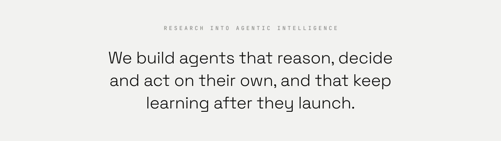
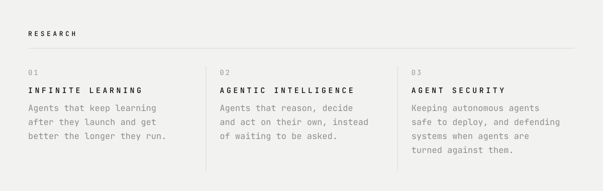
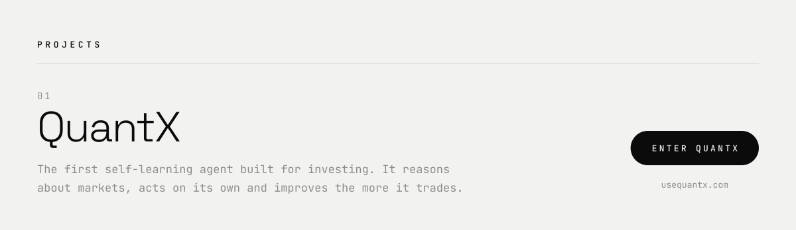

<a href="https://agenticslabs.xyz">
  <picture>
    <source media="(prefers-color-scheme: dark)" srcset="assets/banner-dark.png">
    
  </picture>
</a>

<picture>
  <source media="(prefers-color-scheme: dark)" srcset="assets/statement-dark.svg">
  
</picture>

<picture>
  <source media="(prefers-color-scheme: dark)" srcset="assets/research-dark.svg">
  
</picture>

<a href="https://usequantx.com">
  <picture>
    <source media="(prefers-color-scheme: dark)" srcset="assets/project-quantx-dark.svg">
    
  </picture>
</a>

 
 

  <a href="https://agenticslabs.xyz"><picture><source media="(prefers-color-scheme: dark)" srcset="assets/link-website-dark.svg"></picture></a>
  &nbsp;
  <a href="https://usequantx.com"><picture><source media="(prefers-color-scheme: dark)" srcset="assets/link-quantx-dark.svg"></picture></a>

