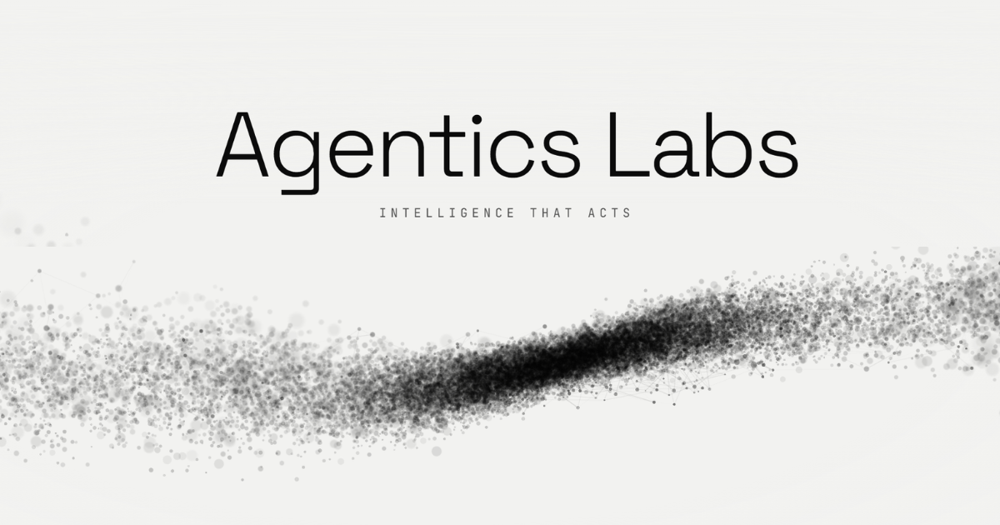

  

Agentics Labs researches agentic intelligence. We build agents that reason, decide and act on their own,
and that keep learning after they launch.

## Projects

| Project | What it is |
|---|---|
| [QuantX](https://usequantx.com) | The first self-learning agent built for investing. |

<!--
To list Kagami at launch, add this row to the table above once kagami.agenticslabs.xyz is live.
| [Kagami](https://kagami.agenticslabs.xyz) | Open-source, deception-based defence against AI-driven attacks. Source on [GitHub](https://github.com/agenticslabs-xyz/kagami). |
-->

## Research areas

- Agents that keep learning after they launch and improve the longer they run
- Agents that reason, decide and act without waiting to be asked
- Safety and security of autonomous agents, including defending systems against AI-driven attacks

## How we work

- Research we publish comes with its method and raw data, so others can check it.
- Security issues in our public repositories are reported privately, as described in each repository's security policy.

## Links

- Website at [agenticslabs.xyz](https://agenticslabs.xyz)
- QuantX at [usequantx.com](https://usequantx.com)
- [QuantX on X](https://x.com/QuantX_OS)
